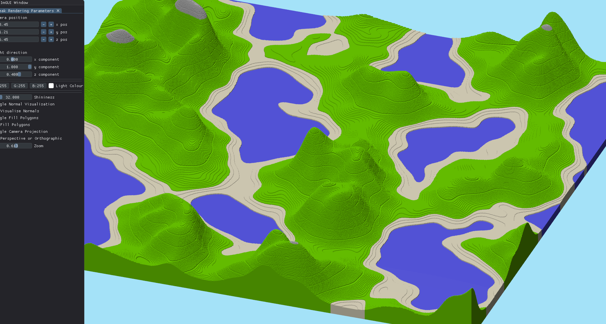
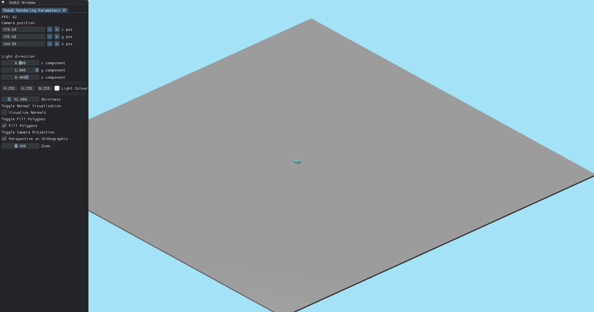

# Voxel Wizard (OpenGL)

## About The Project

A descendent of my ongoing InfiniteVoxelTerrain project, Voxel Wizard will be a 2.5 Iso Voxel game about a wizard
fighting off hordes of monsters and other wizards?

Currently a work in progress...

This project features a detailed Change Log to keep track of the things that will be added and serves me to 
be able to reflect on the changes the project goes through.


1. Perlin Noise Generated terrain showing how block data is rendered.

2. Featureless terrain with a placeholder model for The Wizard (a.k.a the player) sitting in the middle.

## Built With

This project was built with the following third party dependencies:

* [OpenGL](https://www.opengl.org/)
* [DearImGui](https://github.com/ocornut/imgui)
* [GLM](https://glm.g-truc.net/0.9.9/index.html)
* [GLFW](https://www.glfw.org/)
* [Glad](https://github.com/premake-libs/glad?tab=readme-ov-file)
* [stb](https://github.com/nothings/stb)
* [FastNoiseLite](https://github.com/Auburn/FastNoiseLite)

## Building Instructions

#### Building Requirements:
* CMake
* C++ Compiler

For Windows:
```bash
git clone https://github.com/Joseph-RF/VoxelWizard.git
cd VoxelWizard
mkdir build
cd .\build\
cmake ..
cmake --build .
```

## Sources:

* [Voxel World Optimisations](https://vercidium.com/blog/voxel-world-optimisations/)
Vericidium article on general optimisations for voxel engine
* [Let's Make a Voxel Engine](https://sites.google.com/site/letsmakeavoxelengine/home?authuser=0)
* [Meshing in a Minecraft Game](https://0fps.net/2012/06/30/meshing-in-a-minecraft-game/)
More optimisations
* [Voxel Engine in a Weekend](https://daymare.net/blogs/voxel-engine-in-a-weekend/)
Article for getting started on a voxel engine. At the end of the article there are a lot of
pointers on how to improve it
* [General Youtube Search for optimisations](https://www.youtube.com/results?search_query=voxel+engine+optimisations)
* [I Optimised My Game Engine Up To 12000 FPS](https://www.youtube.com/watch?v=40JzyaOYJeY)
* [Perlin Noise: A Procedural Generation Algorithm](https://rtouti.github.io/graphics/perlin-noise-algorithm)
* [A Simple Entity Component System (ECS) (C++)](https://austinmorlan.com/posts/entity_component_system/)
* [Game Programming](https://davechurchill.ca/teaching/)